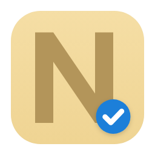
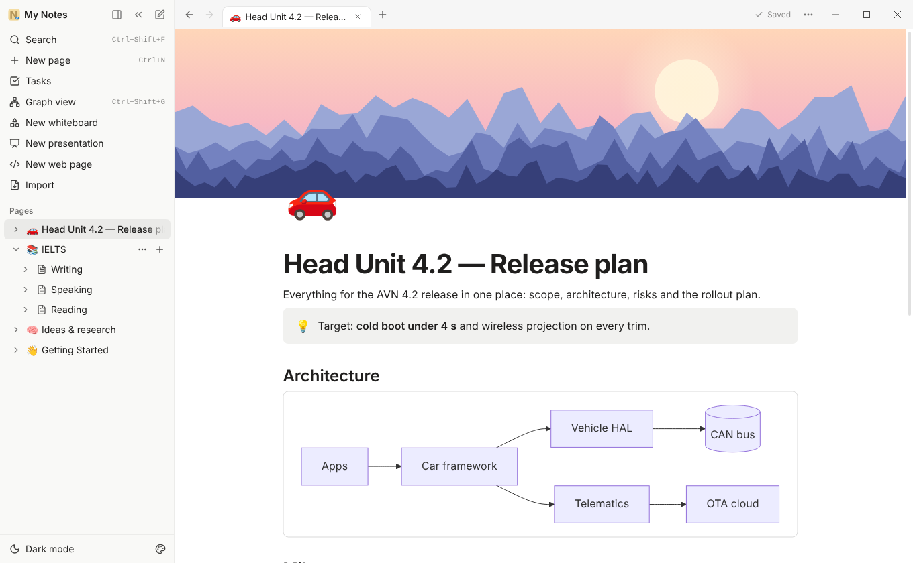
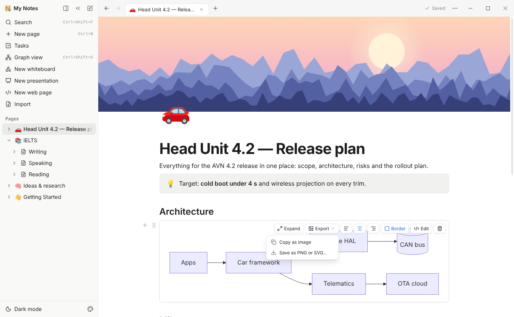
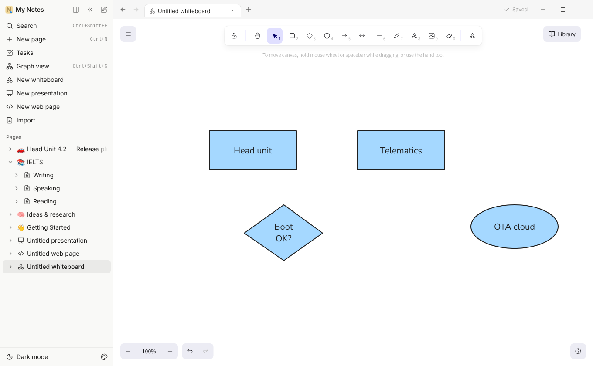
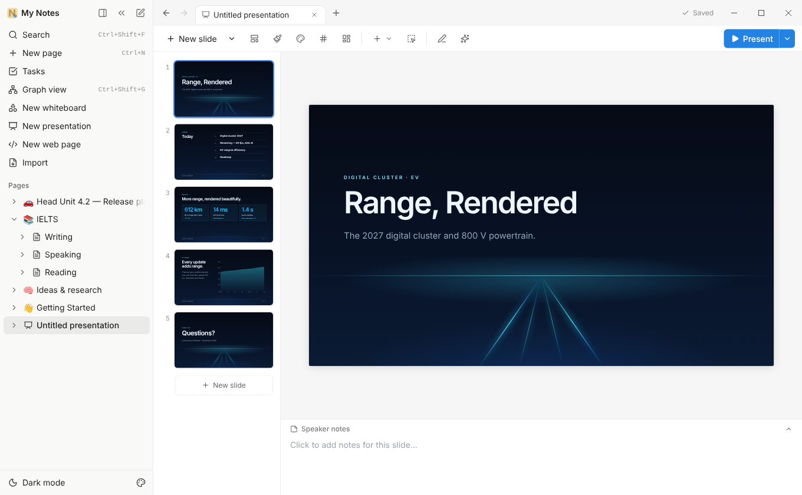
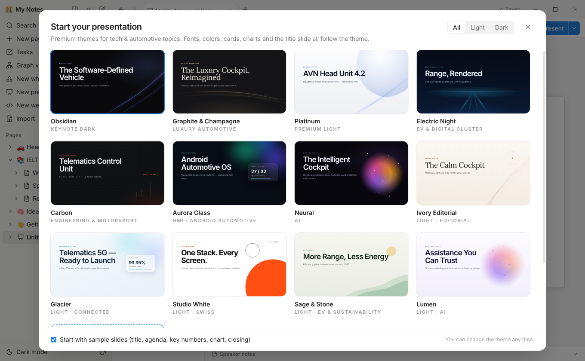
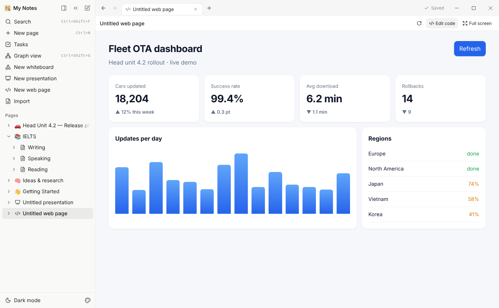
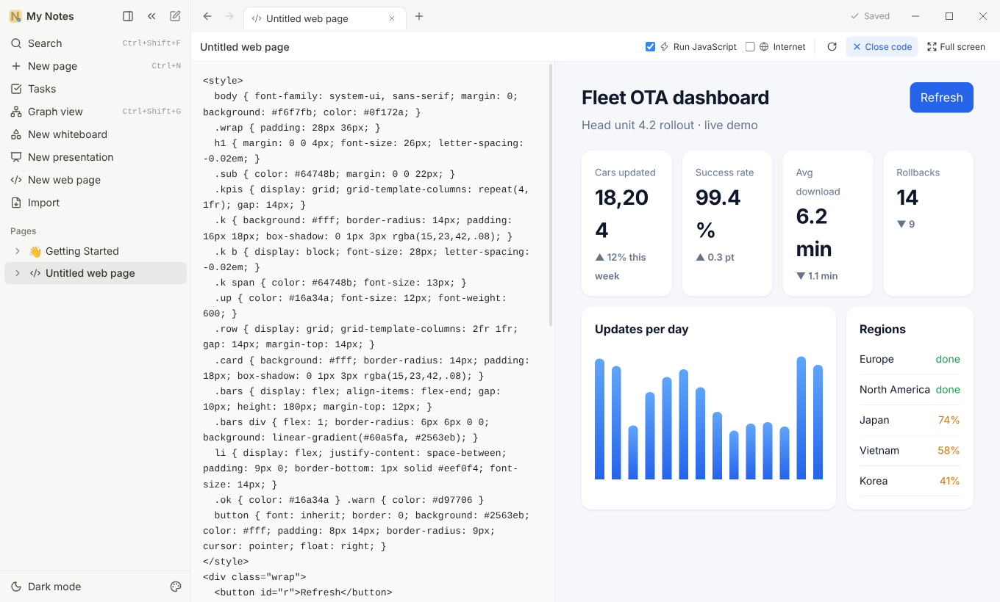
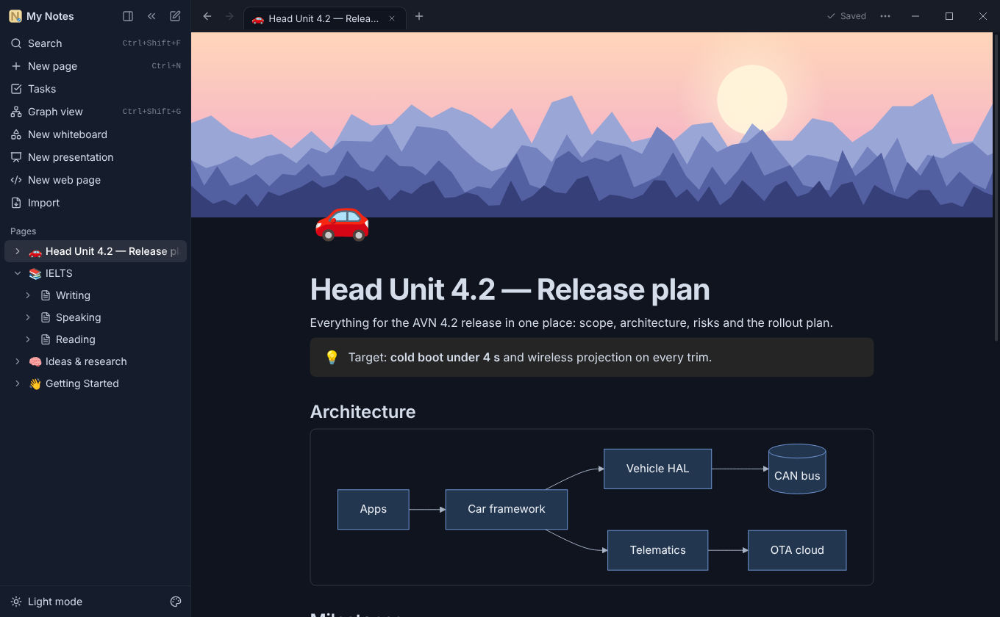
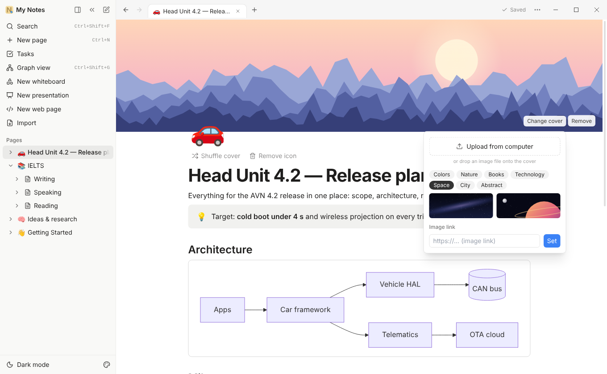

# PremiumNote

**Notes, diagrams, slides and whiteboards: one beautiful app, on your computer.**

Write like in Notion, draw like on a whiteboard, present like in Keynote and build little web apps,
all in the same workspace. Fast, offline, private. Your notes never leave your computer.

[**⬇ Download for Windows**](https://github.com/Thuongst97/MyNoteApplication/releases/latest) · [What's inside](#everything-in-one-place) · [Why PremiumNote](#why-premiumnote) · [FAQ](#faq)

 

---

## Why PremiumNote?

Most of us juggle five apps: one for notes, one for diagrams, one for slides, a whiteboard, and something
to keep tasks in. PremiumNote puts them in **one workspace that runs on your own computer**.

- 🔒 **Private by design.** Everything is stored as files on your computer. No account, no cloud and no tracking.
- ⚡ **Fast and offline.** Opens instantly and works on a plane. Nothing to sync, nothing to wait for.
- 🧩 **Blocks for everything.** Text, tables, charts, code, diagrams, drawings, mind maps, maths and live web pages, all in the same page.
- 🎨 **Looks premium.** 13 app themes, illustrated covers, and presentation themes that make your slides look designed.
- 🛠 **Made for builders.** Mermaid and PlantUML diagrams, highlighted code, Markdown, and interactive HTML that you can run, all built in.

---

## Everything in one place

### ✍️ Write: pages that feel effortless

Type `/` to add anything: headings, to-dos, toggles, callouts, columns, tables, images, quotes, code and equations.
Drag blocks with the ⋮⋮ handle, nest pages as deep as you like, and drag pages in the sidebar to reorganise them.

- **Markdown in, Markdown out:** paste Markdown and it becomes real blocks. Copy any page as Markdown, plain text, or rich text with images, ready for Jira, Confluence or email.
- **Office-style formatting:** font colour and fill palettes, text alignment, and text sizes.
- **Links between pages:** type `@` or `[[` to link a page, link to a single block, see backlinks, and explore everything in the **Graph view**.
- **Find anything:** `Ctrl+F` in a page, or `Ctrl+Shift+F` across all your pages.

### 🧭 Diagram: from text or by hand

- **Mermaid and PlantUML:** write a diagram as text and see it drawn as you type. Flowcharts, sequence diagrams, class and state diagrams, Gantt charts and more.
- **Export in one click:** copy a diagram as a sharp image (paste it straight into Jira, Teams or email) or save it as PNG or SVG.
- **Expand** any diagram to a full-window view with zoom and pan. Great for big sequence diagrams.
- **Charts:** bar, line, area, pie and donut charts from a small table, with labels, legends and colours you can style.
- **Mind maps** that you can rearrange freely.

### 🖍 Sketch: whiteboards and drawings

An infinite whiteboard, or a drawing right inside a page. Shapes come **filled, like in PowerPoint**:
select one and just type to put text in it. Arrows, pen, images and shape libraries are all included.

### 🎤 Present: slides that look designed

Pick a theme and get a finished starter deck in seconds. Choose from **12 premium themes**, light and dark:
Obsidian, Platinum, Electric Night, Ivory Editorial, Glacier, Studio White, Lumen and more.

- Move and resize anything on a slide: text, charts, code, diagrams and images.
- Transitions, animations, a laser pointer and drawing on slides while you present.
- Slide master, footer, slide numbers and speaker notes.

### 🌐 Build: live web pages inside your notes

A **web page** is a whole page that runs your own HTML, CSS and JavaScript. Use it for a dashboard, a calculator,
a prototype or a demo. Edit the code next to a live preview, with **colour highlighting** and a one-click **Format**,
then go **full screen**.

Scripts run in a **locked sandbox**: they can't see your notes, your files or the app. Internet access is **off
until you turn it on**, and pages you receive from someone else wait for you to press **Run**.

### ✅ Organise: tasks and reminders

A built-in **Eisenhower matrix** (Do / Schedule / Delegate / Eliminate) with due dates and desktop reminders,
so your to-dos live next to your notes.

### 🎨 Make it yours

<table>
<tr>
<td width="50%"></td>
<td width="50%"></td>
</tr>
<tr>
<td align="center"><b>13 app themes</b>: Pure White, Paper, Mint, Sky, Lavender, Midnight, Forest…</td>
<td align="center"><b>Illustrated covers</b>: nature, books, technology, space, city, abstract</td>
</tr>
</table>

- **Per-page fonts:** Default, Serif, Mono, Writer, Rounded, Handwriting and more.
- **Page width:** narrow for reading, full width for tables and dashboards.
- **Sidebar on the left or the right:** just drag it across.
- **Tabs, keyboard shortcuts**, and `Ctrl + mouse wheel` to zoom.

---

## Get started in a minute

1. **Download** the latest `PremiumNote-Setup-x.y.z.exe` from [Releases](https://github.com/Thuongst97/MyNoteApplication/releases/latest).
2. **Install.** The installer isn't code-signed yet, so Windows SmartScreen may warn you: click **More info → Run anyway**.
3. **Open PremiumNote.** The *Getting Started* page walks you through the basics. Press `/` on an empty line to see everything you can add.

Installing a new version over an old one **keeps all your notes**.

> **macOS and Linux:** the app runs there too. Build it from source with the [developer guide](docs/DEVELOPMENT.md).
> On Apple Silicon Macs, use the `mac-arm64` build for full speed.

### Handy shortcuts

| Do this | Press |
| --- | --- |
| Add any block | `/` |
| New page | `Ctrl+N` |
| Search all pages | `Ctrl+Shift+F` |
| Find in this page | `Ctrl+F` |
| Light / dark mode | `Ctrl+Shift+L` |
| Show / hide the sidebar | `Ctrl+\` |
| Graph view | `Ctrl+Shift+G` |

*(On a Mac, use `⌘` instead of `Ctrl`.)*

---

## Your notes stay yours

- **Stored on your computer** as plain files, in `%APPDATA%\PremiumNote` on Windows and `~/Library/Application Support/PremiumNote` on macOS. You can back them up like any other folder.
- **No account, no cloud, no analytics.** The app works fully offline.
- **Share when you want:** export a page (with its sub-pages and images) as a `.ncpage` file, or copy it as Markdown or rich text.
- **Security first:** imported content is cleaned, scripts run in a sandbox, and every release is checked with an automated test suite (650+ tests) and a dependency security audit.

---

## FAQ

**Is it free?**
Yes. Download it from the [Releases](https://github.com/Thuongst97/MyNoteApplication/releases/latest) page.

**Does it need the internet?**
No. Only two optional things go online: PlantUML diagrams (rendered by a PlantUML server you choose) and web pages where you turn on *Internet*.

**Can I bring my notes from Notion, Obsidian or VS Code?**
Paste Markdown and it becomes real blocks, or use **Import** to open `.md` files as pages.

**Can others see my pages?**
No. Nothing is published or shared unless you export or copy it yourself.

**Can I get my notes out again?**
Any time: copy a page as Markdown, plain text or rich text, export page files, or save diagrams as PNG/SVG.

---

**Notes, diagrams, slides and web pages: everything in one place.**

[⬇ Download PremiumNote](https://github.com/Thuongst97/MyNoteApplication/releases/latest)

Built with Electron, React, TipTap, Excalidraw and Mermaid. Want to build it yourself or contribute? See the [developer guide](docs/DEVELOPMENT.md).

